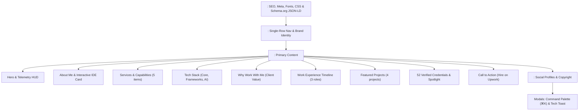

# 🚀 Abraham Worku — Portfolio Website Documentation

Comprehensive architectural and implementation guide for the personal portfolio and developer workbench of **Abraham Worku Gebreselassie** (*Front-End Web Developer*).

---

## 📑 Table of Contents
1. [Project Overview](#-project-overview)
2. [Key Architecture & Core Principles](#-key-architecture--core-principles)
3. [File & Directory Structure](#-file--directory-structure)
4. [HTML Architecture & Structure](#-html-architecture--structure)
   - [Document Head, Meta & SEO](#1-document-head-meta--seo)
   - [Structured Data (Schema.org JSON-LD)](#2-structured-data-schemaorg-json-ld)
   - [Header & Single-Row Navigation](#3-header--single-row-navigation)
   - [Hero Section & Telemetry HUD](#4-hero-section--telemetry-hud)
   - [About Section & Interactive IDE Workbench](#5-about-section--interactive-ide-workbench)
   - [Services Section](#6-services-section)
   - [Skills & System Stack](#7-skills--system-stack)
   - [Why Work With Me](#8-why-work-with-me)
   - [Work Experience Timeline](#9-work-experience-timeline)
   - [Featured Projects](#10-featured-projects)
   - [Verified Credentials & Badges (52 Badges)](#11-verified-credentials--badges-52-badges)
   - [Call to Action (CTA) & Footer](#12-call-to-action-cta--footer)
   - [Command Palette Modal & Toast Notifications](#13-command-palette-modal--toast-notifications)
5. [CSS Architecture & Design System](#-css-architecture--design-system)
   - [Design Tokens & Variables (`:root`)](#1-design-tokens--variables-root)
   - [Cyberpunk & Telemetry Aesthetic Elements](#2-cyberpunk--telemetry-aesthetic-elements)
   - [Responsive Breakpoints & Media Queries](#3-responsive-breakpoints--media-queries)
   - [Accessibility & Motion Control](#4-accessibility--motion-control)
6. [JavaScript Modules & Interactive Engine](#-javascript-modules--interactive-engine)
   - [1. 2D Canvas Particle Network](#1-2d-canvas-particle-network)
   - [2. CLS-Free Typewriter Engine](#2-cls-free-typewriter-engine)
   - [3. Interactive Credential Filter](#3-interactive-credential-filter)
   - [4. Zero-Thrash Scroll Reveal Animations](#4-zero-thrash-scroll-reveal-animations)
   - [5. High-Performance Nav Scrollspy](#5-high-performance-nav-scrollspy)
   - [6. Mobile Drawer Navigation & Scroll Locking](#6-mobile-drawer-navigation--scroll-locking)
   - [7. Interactive IDE Workbench & Code Copier](#7-interactive-ide-workbench--code-copier)
   - [8. Desktop Spotlight Cursor Tracking](#8-desktop-spotlight-cursor-tracking)
   - [9. Command Palette Modal (⌘K / Ctrl+K)](#9-command-palette-modal-k--ctrlk)
   - [10. Accessible Toast Feedback System](#10-accessible-toast-feedback-system)
7. [Maintenance & How-To Guides](#-maintenance--how-to-guides)
   - [How to Add a New Certificate](#how-to-add-a-new-certificate)
   - [How to Add a New Project](#how-to-add-a-new-project)
   - [How to Modify the IDE Code Tabs](#how-to-modify-the-ide-code-tabs)
   - [Local Development & Deployment](#local-development--deployment)

---

## 🌟 Project Overview

This repository houses a high-performance, single-page developer portfolio designed to showcase front-end engineering expertise, verified credentials, and client-focused freelance services for platforms like Upwork.

The design combines a **dark cyberpunk developer telemetry aesthetic** (matrix grids, status crosshairs, monospace telemetry kickers, HUD status badges) with **rigorous modern front-end best practices** (zero runtime dependencies, semantic HTML5, fluid typography, smooth animations, and WCAG accessibility).

---

## ⚡ Key Architecture & Core Principles

| Principle | Implementation Details |
| :--- | :--- |
| **Zero Runtime Dependencies** | No React, Vue, jQuery, or heavy JS bundles required at runtime. The entire experience runs on native HTML5, CSS3, and modern vanilla ES6+ JavaScript. |
| **Performance-First (100 Core Web Vitals)** | Optimized font loading via `preconnect`, canvas frame throttling, debounced listeners, and layout-shift-free typewriter rendering. |
| **Accessibility (a11y)** | Includes `.skip-link`, `aria-label`, `aria-expanded`, `aria-modal`, `aria-live="polite"`, role attributes, focus rings, and full `prefers-reduced-motion` compliance. |
| **Responsive Everywhere** | Mobile-first architecture with custom fluid typography (`clamp()`), safe-area-inset padding for iOS devices, and scroll-snap badge filters. |
| **Interactive Developer Workstation** | Built-in IDE simulator with tabbed syntax-highlighted code, interactive command palette (`⌘K`), and real-time particle canvas. |

---

## 📁 File & Directory Structure

```text
my-site-main/
├── index.html                   # Complete single-page application (HTML, CSS, JS)
├── README.md                    # This complete documentation file
└── certificates/                # Local verified credential documents & previews
    ├── Coursera-Johns-Hopkins-Web-Development-Specialization.pdf
    ├── Coursera-Johns-Hopkins-Web-Development-Specialization-preview-1.png
    └── BVXDIL43FKOJ.pdf
```

---

## 🏗️ HTML Architecture & Structure

The document is organized into semantic landmark sections:



### 1. Document Head, Meta & SEO
* **Viewport Configuration:** `viewport-fit=cover` ensures full edge-to-edge rendering on modern notch-screen mobile devices.
* **Social Graph Tags:** Complete Open Graph (`og:*`) and Twitter Card (`twitter:*`) meta tags for rich link previews on Upwork, LinkedIn, Discord, and Slack.
* **Data-URI Favicon:** Inline SVG favicon (`AW` monogram on dark background with cyan glow), eliminating extra HTTP roundtrips.
* **Typography:** Preconnected Google Fonts loading:
  * `Plus Jakarta Sans`: Geometric modern sans-serif for body and UI elements.
  * `JetBrains Mono`: Clean monospace for telemetry headers, code blocks, and metrics.
* **Icons:** Font Awesome 6.5.1 CDN for interface iconography.

### 2. Structured Data (Schema.org JSON-LD)
Line `2258` embeds rich schema markup:
```json
{
  "@context": "https://schema.org",
  "@type": "Person",
  "name": "Abraham Worku Gebreselassie",
  "alternateName": "Abraham Worku",
  "jobTitle": "Front-End Web Developer",
  "url": "https://www.upwork.com/freelancers/~01ae0d1ace8d1442d3",
  "sameAs": [
    "https://github.com/abrahamwgs",
    "https://www.linkedin.com/in/abraham-worku-286339231",
    "https://www.credly.com/users/abraham-worku.1b641880"
  ],
  "knowsAbout": [...]
}
```
Enhances search engine indexing and knowledge-graph understanding of developer skills.

### 3. Header & Single-Row Navigation
* **Brand Identity:** Avatar pill (`AW`) with live `DEV_READY` pulsing status dot.
* **Navigation Links:** Smooth scrolling links targeting `#about`, `#services`, `#skills`, `#why-me`, `#experience`, `#projects`, and `#credentials`.
* **Action Utilities:**
  * Quick search button triggering the Command Palette (`⌘K`).
  * Direct Upwork hire CTA with custom Upwork green button styling.
  * Mobile animated hamburger toggle with accessibility attributes (`aria-expanded`, `aria-controls`).

### 4. Hero Section & Telemetry HUD
* **Status Badges:** `Available for Freelance Opportunities on Upwork` & `AI-Accelerated`.
* **Developer Telemetry HUD:** High-tech header bar with live simulated metrics:
  * `SYS: ONLINE` &bull; `git:main` &bull; `AI_ACCELERATED` &bull; `OPEN FOR CONTRACTS`.
* **Dynamic Typewriter Headline:**
  * `developer.specialization =` followed by an auto-typing loop alternating between *Front-End Web Developer*, *Modern UI Specialist*, and *AI-Assisted Developer*.
* **Client Vision Box:** Direct client-facing quote addressing prospective clients.
* **Metrics Matrix:** 4 cards presenting key stats (52+ Badges, 100% Responsive, Fast Velocity, Modern Architecture).

### 5. About Section & Interactive IDE Workbench
* **Profile Narrative:** Clear value statement on combining foundational coding standards with AI-accelerated workflows.
* **Interactive IDE Card:** A three-tab code simulator mimicking a modern editor:
  * **Tab 1 (`developer.config.ts`):** TypeScript interface defining Abraham's stack, guarantees, and methods.
  * **Tab 2 (`terminal.sh`):** Simulated shell output displaying clean Git status, Lighthouse 100/100 audit scores, and badge verification.
  * **Tab 3 (`design-tokens.css`):** Design tokens matrix documenting the palette, typography, and elevations.
  * **Interactive Code Copy:** One-click copy button with clipboard API integration and checkmark feedback.

### 6. Services Section
Five structured cards detailing frontend solutions:
1. Full Website Design & Development
2. Landing Pages & Business Websites
3. Portfolios & Academic Hubs
4. Fully Responsive UI
5. Bug Fixing & Performance Optimization

### 7. Skills & System Stack
Categorized skill pill badges:
* **Core Standards:** Semantic HTML5, CSS3 (Modern Flex/Grid), JavaScript (ES6+), Web Accessibility (a11y), Responsive Layouts.
* **Frameworks & Libraries:** React, Bootstrap, Tailwind CSS, Three.js, GSAP.
* **Workflow & AI Tools:** Git, GitHub, Cursor AI, AI-Assisted Workflows, Prompt Engineering.

### 8. Why Work With Me
Three core client value pillars:
1. `01 // Fast Delivery` (AI acceleration without cutting quality)
2. `02 // Pixel-Perfect & Responsive` (standards-compliant code across all screens)
3. `03 // Clear Communication` (proactive collaboration, regular updates, milestone tracking)

### 9. Work Experience Timeline
Vertical timeline featuring 3 career milestones:
* **Freelance Front-End Developer** &bull; *Upwork & Independent Clients* (2024 – Present)
* **Web Developer** &bull; *Habiye Academy* (Custom multi-step student registration platform)
* **Web Development Intern** &bull; *CodeAlpha* (Virtual engineering internship)

### 10. Featured Projects
Showcase grid of practical systems:
* **Habiye Academy:** Custom registration and admission portal (PHP / Full-Stack).
* **Dr-Goraw:** Interactive frontend web application hosted on GitHub Pages.
* **AskDocs:** Document exploration & QA platform with vector search and AI workflows.
* **SentimentScope:** Real-time NLP sentiment analysis and visual reporting tool.

### 11. Verified Credentials & Badges (52 Badges)
Interactive credential section syncing 52 verified credentials across Cisco, IBM, Meta, Scrimba, O'Reilly, MongoDB, Coursera, Udacity, and Udemy.
* **Interactive Category Filtering:**
  * `all`: All 52 credentials
  * `web`: Front-End & Modern Web Architecture
  * `ai`: AI Engineering, Cursor AI & Agentic Workflows
  * `data`: Data, Databases & Vector Search
  * `foundations`: Languages, Mobile & Foundations
* **Specialization Spotlight:**
  * Dedicated banner highlighting the **Johns Hopkins University: HTML, CSS, and Javascript for Web Developers Specialization** (4/4 courses completed).
  * Direct link to local PDF certificate (`certificates/Coursera-Johns-Hopkins-Web-Development-Specialization.pdf`) and Coursera verification (`BVXDIL43FKOJ`).

### 12. Call to Action (CTA) & Footer
* **Conversion Banner:** Clear prompts to start a contract on Upwork or connect via LinkedIn.
* **Footer:** Social icons (Upwork, GitHub, LinkedIn, Credly) and copyright notice.

### 13. Command Palette Modal & Toast Notifications
* **Command Palette Modal (`#cmd-palette-backdrop`):** Floating keyboard-driven spotlight dialog (`⌘K` / `Ctrl+K`) for fast keyboard navigation and actions.
* **Tech Toast (`#tech-toast`):** Minimal popup element informing the user of copy actions.

---

## 🎨 CSS Architecture & Design System

### 1. Design Tokens & Variables (`:root`)
All styling is parameterized through CSS Custom Properties defined at the root:

```css
:root {
  /* Brand Accents */
  --primary: #38bdf8;             /* Neon Cyan */
  --primary-hover: #7dd3fc;
  --primary-dim: rgba(56, 189, 248, 0.12);
  --primary-glow: rgba(56, 189, 248, 0.28);
  --primary-border: rgba(56, 189, 248, 0.24);

  /* Secondary Accents */
  --accent-indigo: #818cf8;
  --accent-purple: #c084fc;
  --neon-cyan: #00f0ff;
  --neon-emerald: #10b981;

  /* Upwork Brand Theme */
  --upwork: #14a800;
  --upwork-dim: rgba(20, 168, 0, 0.14);
  --upwork-glow: rgba(20, 168, 0, 0.35);

  /* Dark Theme Surfaces */
  --bg: #030712;
  --bg-surface: #0b0f19;
  --card-bg: rgba(11, 15, 25, 0.75);
  --card-bg-hover: rgba(20, 28, 45, 0.85);

  /* Typography Colors */
  --text: #f8fafc;
  --text-soft: #cbd5e1;
  --muted: #94a3b8;
  --muted-2: #64748b;

  /* Borders & Radii */
  --border: rgba(255, 255, 255, 0.08);
  --border-hover: rgba(56, 189, 248, 0.4);
  --radius-sm: 8px;
  --radius: 16px;
  --radius-lg: 24px;
  --radius-pill: 999px;
  --header-h: 72px;
  --font-mono: 'JetBrains Mono', monospace;
}
```

### 2. Cyberpunk & Telemetry Aesthetic Elements
* **Background Grid & Radial Glows:** Dual-layer background with subtle cyan, indigo, and green ambient light cones overlaid on a 36px &times; 36px subtle grid matrix.
* **Telemetry Kickers (`.section-kicker-bar`):** Monospaced status bars with section numbering (e.g., `// 01. OVERVIEW & PHILOSOPHY [SPEC: DEV_PROFILE_V2]`).
* **Crosshair Corners (`.card-crosshair` / `.metric-corner-*`):** Technical plus signs (`+`) positioned at card vertices for a blueprint engineering feel.
* **Pulsing Status Dots (`.status-dot` / `.hud-led`):** CSS keyframe animated green and cyan indicators showing live readiness.

### 3. Responsive Breakpoints & Media Queries
* **Desktop (>1024px):** Multi-column project grids, full IDE code workbench, horizontal telemetry HUD.
* **Tablet (840px):** Single-column layout adjustments, navigation collapses into slide-down mobile drawer.
* **Mobile (<=640px):**
  * Credential filter buttons switch to horizontal scrollable bar with scroll-snapping (`scroll-snap-type: x proximity`).
  * Full-width action buttons with vertical stacking.
  * Automatic padding protection for safe-area insets (`env(safe-area-inset-*)`).

### 4. Accessibility & Motion Control
* **`prefers-reduced-motion` Media Query:** Automatically halts the canvas particle engine, disables typewriter animations (defaults to static text), and skips reveal transitions to respect user preferences.
* **Strict Focus Visibility:** High-contrast cyan outline (`2px solid var(--primary)`) with positive offset (`outline-offset: 3px`) for all keyboard navigators.
* **Touch Optimization:** `touch-action: manipulation` applied to interactive targets to eliminate double-tap zoom delays on mobile browsers.

---

## ⚙️ JavaScript Modules & Interactive Engine

The script at the bottom of `index.html` (lines `3327–3893`) is organized into dedicated, conflict-free modules:

### 1. 2D Canvas Particle Network
* **Element:** `<canvas id="bg-canvas">`
* **Mechanics:** Spawns particles (60 on desktop, 22 on mobile) that drift with subtle randomized velocity vectors (`vx`, `vy`).
* **Connection Distance:** Connects neighbouring nodes when within `110px`, and connects to the cursor position within `125px`.
* **Battery & CPU Throttling:** Listens to `document.visibilitychange` to completely pause the animation loop (`cancelAnimationFrame`) when the user switches tabs.

### 2. CLS-Free Typewriter Engine
* **Cumulative Layout Shift Prevention:** Before starting the animation, the script uses an invisible off-screen probe (`probe.style.cssText = 'position:absolute;visibility:hidden...'`) to measure the widest string among all titles, then sets `min-width` on the container. This guarantees zero layout shifting while typing.
* **State Machine:** Steps through `charIndex` for forward typing (90ms) and reverse deleting (45ms) with natural pausing (1800ms) between words.

### 3. Interactive Credential Filter
* Filters credential groups (`.cert-group`) using the `data-category` attribute.
* Toggles `.active` classes on filter buttons and smoothly scrolls selected chips into view on mobile viewports.

### 4. Zero-Thrash Scroll Reveal Animations
* Uses high-efficiency `IntersectionObserver` with a `-40px` root margin to trigger `.reveal.active` CSS transitions when elements enter the viewport.
* Immediately unobserves revealed elements, eliminating ongoing scroll performance penalties.

### 5. High-Performance Nav Scrollspy
* Uses an IntersectionObserver threshold matrix (`[0, 0.2, 0.4, 0.6, 0.8, 1.0]`) to continuously measure section visibility ratios and highlight the corresponding active link in the navigation bar.
* Features a fallback requestAnimationFrame scroll listener for legacy browsers.

### 6. Mobile Drawer Navigation & Scroll Locking
* Toggles `.open` state on the navigation drawer and hamburger button.
* Temporarily sets `document.body.style.overflow = 'hidden'` when open to prevent background scrolling on mobile.
* Closes gracefully on backdrop click, link click, or pressing `Escape`.

### 7. Interactive IDE Workbench & Code Copier
* Handles tab switching (`developer.config.ts`, `terminal.sh`, `design-tokens.css`) by toggling `.active` classes and updating `aria-selected` states.
* Integrates `navigator.clipboard.writeText()` with a temporary button icon swap (`check` icon for 2s) and toast notification.

### 8. Desktop Spotlight Cursor Tracking
* Gated behind `(hover: hover) and (pointer: fine)`.
* Listens to mouse coordinates within cards and updates `--mouse-x` and `--mouse-y` CSS properties to render a radial spotlight glow underneath the cursor.

### 9. Command Palette Modal (⌘K / Ctrl+K)
* **Global Shortcut:** Listens for `Ctrl + K` (Windows/Linux) or `Cmd + K` (macOS) anywhere on the page.
* **Instant Filtering:** Real-time search across item titles and `data-keywords` attributes.
* **Keyboard Navigation:** Full support for `ArrowDown`, `ArrowUp`, `Enter` to select, and `Escape` to dismiss.
* **Built-in Actions:**
  * Jumps to sections (`#about`, `#services`, `#skills`, etc.).
  * One-click copy email (`workuabraham68@gmail.com`).
  * One-click copy active IDE code.
  * Direct external links (Upwork, GitHub, LinkedIn, Credly).

### 10. Accessible Toast Feedback System
* Provides non-intrusive confirmation messages via an accessible live region (`role="status"`, `aria-live="polite"`).
* Automatically dismisses after 2.8 seconds.

---

## 🛠️ Maintenance & How-To Guides

### How to Add a New Certificate
When you earn a new certification:

1. **Locate the Target Category in `index.html`:**
   * Category 1: Web & Architecture (`data-category="web"`, ~line 3008)
   * Category 2: AI & Agentic Workflows (`data-category="ai"`, ~line 3109)
   * Category 3: Databases & Vector Search (`data-category="data"`, ~line 3200)
   * Category 4: Languages & Foundations (`data-category="foundations"`, ~line 3245)

2. **Insert the New Badge Link:**
   ```html
   <a href="YOUR_VERIFICATION_URL" target="_blank" rel="noopener noreferrer" class="cert-tag">
     <span class="cert-tag-title"><i class="fa-solid fa-award" aria-hidden="true"></i> Certificate Title</span>
     <span class="cert-tag-issuer">Issuing Organization</span>
   </a>
   ```

3. **Update the Total Count Numbers (e.g. from 52 to 53):**
   * **Hero metric:** `<div class="metric-num">53+</div>`
   * **IDE config tab:** `<span class="c-prop">credentialsVerified</span>: <span class="c-num">53</span>,`
   * **IDE terminal tab:** `<span class="t-yellow">&check; 53 Verified Credentials Synced ...</span>`
   * **Credentials kicker:** `[INDEX: 53_VERIFIED // ZERO_EXCLUSIONS]`
   * **Cert stats banner:** `53 Verified Credentials & Badges`
   * **Filter button:** `<button class="filter-btn active" data-filter="all">All Credentials (53)</button>`
   * **Command palette:** `<span>Verified Credentials (53)</span>`

---

### How to Add a New Project
In the `<section id="projects">` grid (~line 2874):

```html
<div class="project-card">
  <div>
    <div class="project-top-meta">
      <span class="project-kicker">Application Type</span>
      <span class="project-status-tag"><i class="fa-solid fa-code-branch"></i> Live / Repository</span>
    </div>
    <h3 class="project-title">Your Project Name</h3>
    <p class="project-desc">Clear, 2-line summary of what the system does and key user benefits.</p>
    <div class="project-tags">
      <span class="p-tag">React</span>
      <span class="p-tag">Tailwind CSS</span>
      <span class="p-tag">TypeScript</span>
    </div>
  </div>
  <div class="project-actions">
    <a href="URL" target="_blank" rel="noopener noreferrer" class="btn btn-outline">
      <i class="fa-brands fa-github"></i> View Repository
    </a>
  </div>
</div>
```

---

### How to Modify the IDE Code Tabs
To customize the snippet displayed inside the IDE simulator in the About section:
* Edit lines `2498–2515` for the TypeScript profile (`#tab-config`).
* Edit lines `2517–2530` for the Terminal console (`#tab-terminal`).
* Edit lines `2532–2545` for the CSS tokens matrix (`#tab-tokens`).

Syntax highlighting is achieved with custom CSS utility classes:
* `.c-keyword` (Cyan / Purple)
* `.c-type` / `.c-var` (Yellow / White)
* `.c-prop` (Sky Blue)
* `.c-string` (Green)
* `.c-comment` (Muted Grey)

---

### Local Development & Deployment

#### Running Locally
Because this project uses native web standards with zero dependencies, you can run it using any simple static file server:

```bash
# Using Python 3 built-in HTTP server:
python3 -m http.server 8000

# Or using Node.js npx:
npx serve .
```
Then visit `http://localhost:8000` in your browser.

#### Deploying to GitHub Pages
1. Push this directory to your GitHub repository (e.g., `https://github.com/Abrahamwgs/my-site`).
2. Go to **Settings** &rarr; **Pages**.
3. Under **Build and deployment**, select `Deploy from a branch` and choose the `main` branch with folder `/ (root)`.
4. Click **Save**. Your site will be live within seconds with HTTPS enabled.

---

## 📜 Credits & License

* **Developer:** [Abraham Worku Gebreselassie](https://www.upwork.com/freelancers/~01ae0d1ace8d1442d3)
* **Design & Code:** Crafted with semantic HTML5, modern CSS3, and ES6+ JavaScript.
* **Fonts:** [Plus Jakarta Sans](https://fonts.google.com/specimen/Plus+Jakarta+Sans) and [JetBrains Mono](https://fonts.google.com/specimen/JetBrains+Mono).
* **Icons:** [Font Awesome 6](https://fontawesome.com/).

